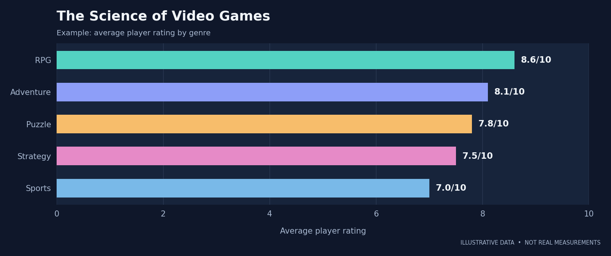
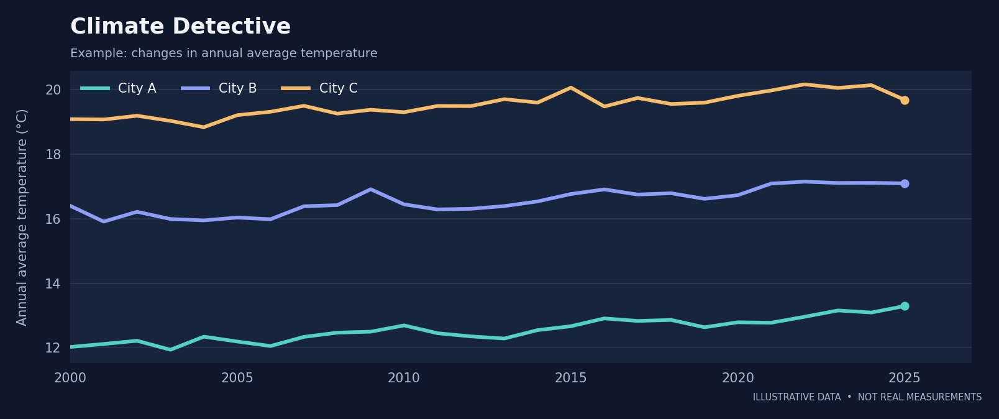
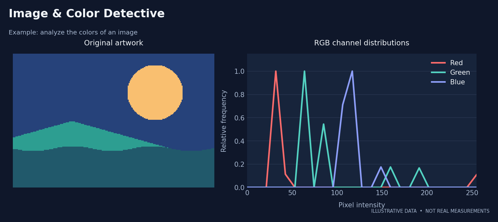
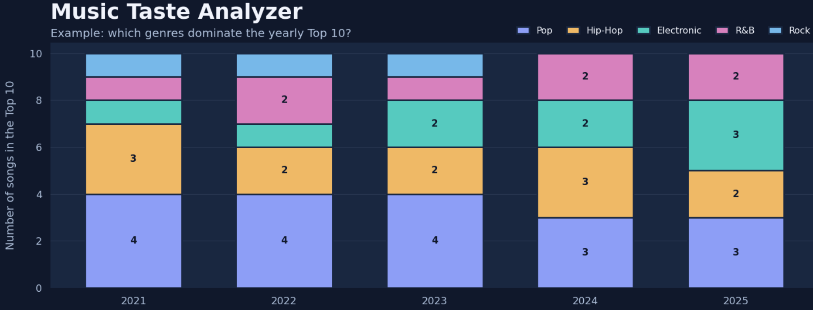

# ADVANCED PYTHON - Project (mini)

## Your Mission

Create an original Python project that uses data to **explore, explain, simulate, or visualize something interesting**.\
You may choose **any topic you want**: science, sports, games, music, society, mathematics, or even an imaginary world.

Your objective is to demonstrate how Python can transform raw information into meaningful results.

You can do it in group of 2 people.

 

## Project Rules

- Use **NumPy, Pandas, and Matplotlib** meaningfully.
- Include at least **4 different visualizations**.
- Explain the purpose of your project and **at least 3 findings**.
- Be creative! Your topic, datasets, questions, and visual presentation are entirely your choice.

## Where to Find Your Dataset

You will find a lot of data on these websites:**.

- [Kaggle Datasets](https://www.kaggle.com/datasets): Games, movies, music, sports, and more.
- [Our World in Data](https://ourworldindata.org/): Climate, society, health, and global statistics.
- [Data.gouv.fr](https://www.data.gouv.fr/datasets/search/): French public datasets.
- [Gapminder](https://www.gapminder.org/data/): Country statistics and trends over time.

## Project Examples

*These are <ins>**suggestions**</ins>, not mandatory topics.*

### 1. The Science of Video Games

Analyze game ratings, prices, playtime, or genres.\
Look for patterns and present your findings visually.

**Possible directions:**
- Do expensive games get better ratings?
- Which genres are the most popular, or have the highest ratings?

 

### 2. Climate Analysis

Explore temperature, rainfall, or extreme weather data to compare places and investigate changes over time.\
Can be at specific areas, or a larger one.

**Possible directions:**
- How have temperatures evolved in different cities?
- Are some seasons becoming hotter or wetter than others?

 

### 3. Image & Color Depth Analysis

Analyze photographs, posters, or game screenshots using pixel arrays. Compare colors, brightness, or visual styles.

**Possible directions:**
- What are the dominant colors in different images?
- How do the color palettes of two movies or games differ?

 

### 4. Music Taste Analyzer

Study song lengths, genres, release years, or audio features to discover patterns in music.

**Possible directions:**
- How have music trends changed over the decades?
- Do different genres have distinct energy or danceability patterns?

 

## What to Submit

- **One Jupyter/Google Colab notebook** with well-organized code, visualizations, and Markdown explanations.
- **Your dataset**, or code that reproduces your generated data.
- **A 3–5 minute presentation** of your project, results, and most interesting discovery.

Make something that interests you, and don't overdo it. :)
